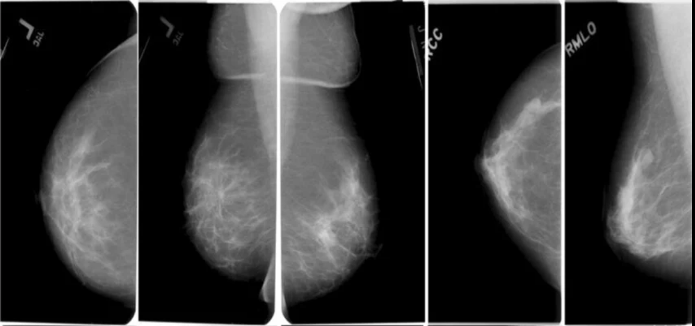
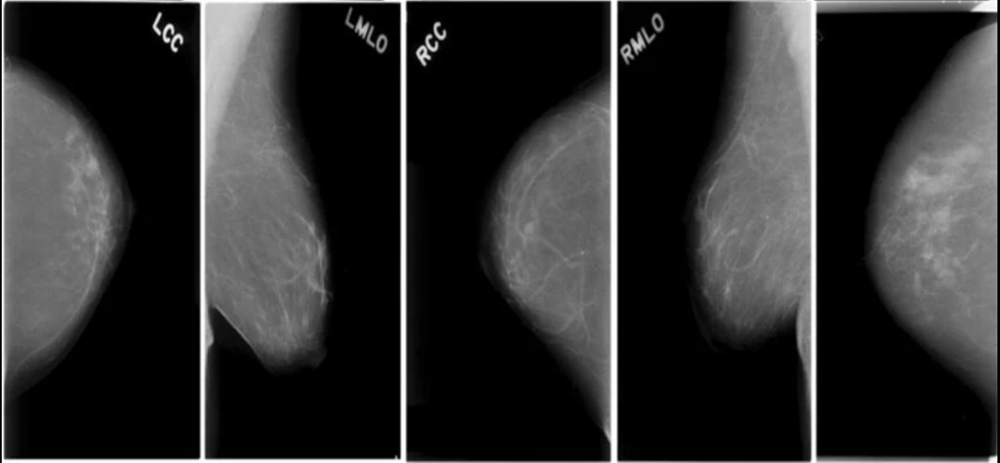

 # Breast Cancer Classification — CNN Training Pipeline

This directory contains the training pipeline for the convolutional neural network used by the Breast Cancer Classification API.

The pipeline uses TensorFlow and Keras to train an EfficientNetB0-based image classifier on the CBIS-DDSM mammography dataset. It performs dataset preparation, transfer learning, fine-tuning, model selection, evaluation, and model export.

The resulting model is intended to integrate with the FastAPI application in the parent directory.

> **Research and educational project:** This model is experimental. Its predictions are not medical diagnoses and must not be used to guide clinical decisions.

## Contents

```text
training/
├── train_cnn.py
├── README.md
└── images/
    ├── cancer-scans.png
    └── non-cancer-scans.png
```

## Dataset

**Dataset:** [CBIS-DDSM: Breast Cancer Image Dataset](https://www.kaggle.com/datasets/awsaf49/cbis-ddsm-breast-cancer-image-dataset)

The Curated Breast Imaging Subset of DDSM (CBIS-DDSM) is a standardized collection of mammography images derived from the Digital Database for Screening Mammography. It includes benign and malignant cases, pathology information, and annotations relating to breast abnormalities.

The Kaggle dataset documentation reports approximately 10,239 images and 1,566 actual participants. It provides JPEG images and CSV metadata for mass and calcification cases.

### Why this dataset?

CBIS-DDSM provides labeled mammography images suitable for experimenting with computer-aided breast lesion classification. Its diagnostic labels allow a supervised learning model to learn visual patterns associated with benign and malignant lesions.

The dataset is not a substitute for a representative clinical dataset. Its images, acquisition methods, participant characteristics, and diagnostic distribution may differ from those encountered in real-world deployment.

### Sample images

The following images provide illustrative examples of cancer-related and non-cancer mammography scans.



*Cancer-related mammography examples.*



*Non-cancer mammography examples.*

These images are included for visual context. They do not represent the complete dataset, the training distribution, or the model's classification performance.

## Classification task

The model performs **binary classification of cropped breast lesion images**.

| Encoded label | Class |
|---|---|
| `0` | Benign |
| `1` | Malignant |

The CSV pathology field supplies the target label. The training script maps pathology values containing `MALIGNANT` to class `1`, and values beginning with `BENIGN` to class `0`. Unsupported or missing labels are excluded.

The model's final layer produces one sigmoid probability representing the estimated probability of the malignant class.

For example, an output of `0.82` represents a model-estimated malignancy probability of 82%. With the script's default evaluation threshold of `0.5`, this would be classified as malignant.

This probability is not a calibrated clinical risk estimate.

**Scope:** This is not a three-class classifier for normal, benign, and malignant mammograms. It does not establish whether a person has breast cancer, and its predictions should not be interpreted independently of clinical assessment.

## Model architecture

The classifier uses **EfficientNetB0 with transfer learning**.

EfficientNetB0 is a convolutional neural network pretrained on ImageNet. Rather than learning all visual features from random initialization, the model starts with features learned from a large image dataset and adapts them to the mammography classification task.

The architecture is composed of the following stages:

1. **Input layer:** accepts RGB images with dimensions of `224 × 224 × 3`.
2. **Data augmentation:** applies random horizontal flips, small rotations, zoom transformations, and contrast adjustments during training.
3. **EfficientNetB0 backbone:** extracts visual features from the input image.
4. **Global average pooling:** converts the backbone's spatial feature maps into a compact feature vector.
5. **Dropout:** randomly disables a proportion of activations during training to help reduce overfitting.
6. **Dense classification layer:** learns task-specific combinations of extracted features using 128 neurons and ReLU activation.
7. **Output layer:** produces a single sigmoid probability for the malignant class.

The overall flow is:

```text
Cropped mammography image
          |
          v
    Resize to 224×224
          |
          v
     Data augmentation
          |
          v
    EfficientNetB0 CNN
    (feature extraction)
          |
          v
 Global Average Pooling
          |
          v
      Dropout (0.35)
          |
          v
 Dense layer (128, ReLU)
          |
          v
      Dropout (0.25)
          |
          v
    Dense layer (1, Sigmoid)
          |
          v
 Probability of malignancy
```

### Why EfficientNetB0?

EfficientNetB0 offers a practical starting point for transfer learning. It provides a substantial pretrained convolutional feature extractor without the computational demands of many larger architectures.

The script also allows training from scratch through the `--weights none` option. The default is `--weights imagenet`.

### Why transfer learning?

Training a deep CNN from scratch requires sufficient labeled data and computational resources. Transfer learning allows the model to begin with pretrained visual representations and learn which features are useful for this particular classification task.

This approach does not guarantee good medical-image performance. ImageNet features were learned from natural images rather than mammograms, so performance must be established experimentally.

### Why global average pooling?

Global average pooling summarizes each feature map instead of flattening every spatial activation into a large vector. This keeps the classification head relatively compact and limits the number of additional parameters.

### Why sigmoid and binary cross-entropy?

The task has two classes, so a single sigmoid output is sufficient to represent the model's estimated probability for the malignant class.

Binary cross-entropy measures the difference between predicted probabilities and binary ground-truth labels. It is optimized using the Adam optimizer.

## Image preprocessing

The script uses TensorFlow's `tf.data` pipeline to load and prepare images efficiently.

The main preprocessing steps are:

- Resolve image paths from the CSV metadata against the extracted JPEG files.
- Decode JPEG files into three-channel RGB images.
- Resize images to `224 × 224` pixels.
- Convert pixel values to floating-point tensors.
- Batch images in groups of eight.
- Prefetch batches to improve input-pipeline efficiency.

EfficientNetB0 in Keras includes its own input rescaling layers. The script therefore keeps resized pixel values in the `0–255` range rather than applying an additional external normalization step.

### Data augmentation

Random transformations are included in the model:

| Transformation | Purpose |
|---|---|
| Horizontal flip | Introduces horizontal variation |
| Small rotation | Adds modest variation in image orientation |
| Zoom | Varies the apparent scale of image features |
| Contrast adjustment | Introduces modest intensity variation |

These transformations are applied during training rather than being deliberately applied to the validation and test images.

Augmentation can help reduce overfitting, but medical-image transformations must be chosen carefully. The transformations used here are experimental choices and have not been clinically validated.

## Training strategy

Training takes place in two phases. This separates adaptation of the classification head from fine-tuning the pretrained feature extractor.

### Phase 1: Train the classification head

The EfficientNetB0 backbone is initially frozen. Its pretrained parameters are not updated, while the newly added classification layers learn to distinguish the two target classes.

Configuration:

| Parameter | Value |
|---|---:|
| Maximum epochs | 8 |
| Learning rate | `0.001` |
| Batch size | 8 |
| Backbone | Frozen |

A relatively higher learning rate is used for the newly initialized classification layers because they must learn task-specific features.

### Phase 2: Fine-tune EfficientNetB0

The best checkpoint from the first phase is loaded. The script then makes the backbone trainable while freezing earlier layers, leaving the upper layers available for adaptation.

Batch-normalization layers remain frozen to avoid unnecessarily changing their learned statistics during fine-tuning.

Configuration:

| Parameter | Value |
|---|---:|
| Maximum epochs | 12 |
| Learning rate | `0.00001` |
| Upper backbone layers considered | 30 |
| Batch size | 8 |

The lower learning rate reduces the magnitude of parameter updates. This helps adapt pretrained features without making large changes to the original representations.

The epoch values are maximums rather than guaranteed training durations because early stopping can end a phase sooner.

### Class imbalance

The script calculates balanced class weights from the training subset. These weights are passed to `model.fit()` so that examples from underrepresented classes receive greater weight in the training loss.

This is relevant because a model trained on an imbalanced dataset can favor the majority class while still achieving seemingly reasonable accuracy.

Class weighting does not replace evaluation on both classes, nor does it guarantee improved sensitivity.

### Reproducibility

The script sets random seeds for Python, NumPy, and TensorFlow using the value `42`. It also configures TensorFlow to allow GPU memory growth when a compatible GPU is detected.

These settings improve reproducibility and GPU memory management, although exact results can still vary with hardware, software versions, and nondeterministic operations.

## Validation and model selection

The supplied training CSVs are combined into a training pool. The script then creates a training/validation split using the `patient_id` field, with 15% of the identified patient groups assigned to validation.

When the split contains both classes, stratification is used to help preserve the class distribution.

Validation ROC-AUC is used to select the best checkpoint. ROC-AUC measures how well a model ranks malignant cases above benign cases across possible classification thresholds.

The script saves the best checkpoint from each training phase and compares them using validation ROC-AUC. The checkpoint with the higher validation score is selected for final export.

### Training callbacks

The script uses several callbacks to control training:

- **ModelCheckpoint:** saves the checkpoint with the highest validation AUC.
- **EarlyStopping:** stops a phase when validation AUC fails to improve for four epochs and restores the best weights for that phase.
- **ReduceLROnPlateau:** reduces the learning rate when validation loss stops improving.
- **CSVLogger:** records training and validation metrics by epoch.
- **TerminateOnNaN:** stops training if a loss value becomes NaN.

These mechanisms help control overfitting and make training behavior easier to inspect. They do not guarantee generalization to new clinical populations.

### Important data-splitting limitation

The script attempts to keep patient groups separate during the training/validation split. However, if `patient_id` is missing, it falls back to an image-level identifier. This fallback does not guarantee that images belonging to the same participant remain in one split.

Furthermore, the source dataset documents multiple patient IDs associated with some participants. Grouping by the CSV `patient_id` field alone may therefore be insufficient to guarantee participant-level separation.

Before interpreting model performance as reliable, the split should be verified using participant identifiers and the dataset's documented structure.

The script also relies on the official test CSVs. Their independence from the training participants should be checked before making strong generalization claims.

## Evaluation

After selecting the checkpoint with the highest validation ROC-AUC, the script evaluates it on the supplied test set using a fixed probability threshold of `0.5`.

The following metrics are calculated:

| Metric | What it measures |
|---|---|
| Accuracy | Proportion of all predictions that are correct |
| Precision | Proportion of predicted malignant cases that are actually malignant |
| Recall / sensitivity | Proportion of actual malignant cases identified as malignant |
| F1-score | Harmonic mean of precision and recall |
| ROC-AUC | Ability to rank malignant cases above benign cases across thresholds |
| Confusion matrix | Counts correct and incorrect predictions for both classes |

Recall deserves particular attention in this task because false negatives—malignant cases classified as benign—are an important failure mode. However, increasing sensitivity can also increase false positives, so a threshold should not be selected based on one metric alone.

The current script uses `0.5` as its evaluation threshold. It does not optimize that threshold for a clinical application.

## Illustrative results — not actual model measurements

> **Placeholder data only.** The model has not yet been trained using the dataset for this repository. The values below are illustrative figures for drafting the project documentation and are not observed experimental results.

| Metric | Illustrative value |
|---|---:|
| Accuracy | 91.0% |
| Precision | 89.0% |
| Recall / sensitivity | 93.0% |
| F1-score | 91.0% |
| ROC-AUC | 0.95 |

These figures must be replaced with the actual held-out test metrics after training. They should not be cited as evidence that this implementation achieves these results.

The script produces a confusion matrix and a classification report as additional evaluation outputs. The saved JSON file contains the numeric metrics.

## Installation and training

### Requirements

Install the dependencies in a Python environment with a compatible TensorFlow installation:

```bash
pip install tensorflow pandas scikit-learn numpy
```

GPU training additionally requires a compatible TensorFlow, CUDA, and GPU configuration. If TensorFlow cannot detect a compatible GPU, the script warns that it will run on the CPU.

### Dataset layout

Download and extract the [CBIS-DDSM dataset from Kaggle](https://www.kaggle.com/datasets/awsaf49/cbis-ddsm-breast-cancer-image-dataset).

The training script searches recursively beneath the supplied dataset root for the following four CSV files:

```text
mass_case_description_train_set.csv
mass_case_description_test_set.csv
calc_case_description_train_set.csv
calc_case_description_test_set.csv
```

It also searches recursively for JPEG images. The CSV paths must resolve to the intended cropped lesion images.

The expected directory layout can vary depending on how the dataset is extracted. The root passed to the script must contain the CSV files and corresponding images somewhere beneath it.

### Run the training script

From the repository root:

```bash
python training/train_cnn.py \
  --data-dir "/path/to/CBIS-DDSM" \
  --output-dir "./training_output"
```

To train without ImageNet pretrained weights:

```bash
python training/train_cnn.py \
  --data-dir "/path/to/CBIS-DDSM" \
  --output-dir "./training_output" \
  --weights none
```

Training from scratch is a separate experimental configuration and should not be assumed to produce the same performance as transfer learning.

## Generated artifacts

The default output directory is `training_output/`.

| File | Purpose |
|---|---|
| `model.h5` | Exported model for inference |
| `model_metadata.json` | Architecture, input format, output meaning, label mapping, and seed |
| `test_metrics.json` | Final test metrics and confusion matrix |
| `test_predictions.csv` | Actual labels, predicted labels, and malignancy probabilities for test images |
| `training_log.csv` | Epoch-level training and validation logs |
| `stage1_best.keras` | Best checkpoint from classification-head training |
| `stage2_best.keras` | Best checkpoint from fine-tuning |

The `.keras` checkpoints are used for training and model selection. The final `model.h5` is exported separately for compatibility with the existing inference application.

The FastAPI application must use compatible preprocessing and interpret the sigmoid output as the probability of the malignant class. Its behavior should be verified against the saved model before deployment.

## Limitations

This implementation has several limitations:

- It performs binary classification of cropped lesion images rather than comprehensive mammogram interpretation.
- Its predictions depend on the quality, labeling, and distribution of the training data.
- Its reported performance will not establish generalization to other institutions or imaging systems.
- Its current patient-splitting fallback does not guarantee participant-level separation.
- A fixed threshold of `0.5` may not be appropriate for a particular application.
- High accuracy or ROC-AUC does not establish clinical safety, calibration, or usefulness.

The model is intended for experimentation and software engineering demonstration. Any potential clinical use would require rigorous external validation, appropriate governance, and assessment by qualified medical professionals.

## Dataset attribution

The CBIS-DDSM collection is described in the following publication:

Lee, R. S., Gimenez, F., Hoogi, A., Kawai Miyake, K., Gorovoy, M., & Rubin, D. L. (2017). *A curated mammography data set for use in computer-aided detection and diagnosis research*. Scientific Data, 4, 170177.

https://doi.org/10.1038/sdata.2017.177

Dataset source: [CBIS-DDSM on Kaggle](https://www.kaggle.com/datasets/awsaf49/cbis-ddsm-breast-cancer-image-dataset)

Users should comply with the applicable dataset licensing terms and the [TCIA Data Usage Policy](https://wiki.cancerimagingarchive.net/x/c4hF).
